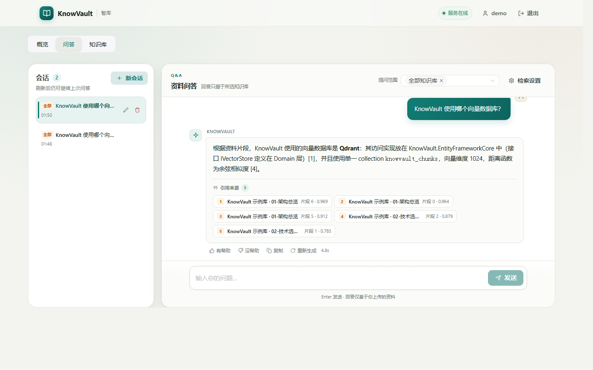
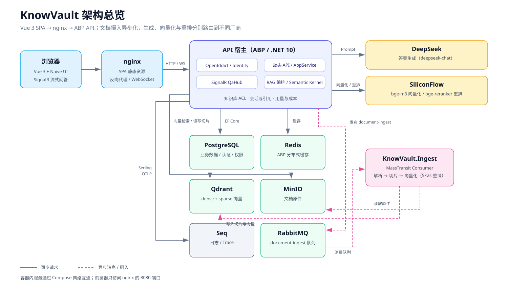

# KnowVault（智库）

> 你问，它从你的文档里找答案。

KnowVault 是一个可本地运行的 **RAG 知识库**作品：上传 PDF / Word / Excel / Markdown / HTML，系统异步解析、切片并向量化；提问时先检索、再生成，答案带引用溯源。

**一条命令启动全部依赖与服务：**

```bash
cp .env.example .env    # 填入 DeepSeek 与 SiliconFlow 的 API Key
docker compose up -d --build
```

打开 <http://localhost:8080>，用 `demo / 1q2w3E*` 登录（仅本地演示）。



技术栈：.NET 10 · ABP VNext · Semantic Kernel ｜ Vue 3 · Vite · Naive UI ｜ PostgreSQL · Redis · Qdrant · MinIO · RabbitMQ ｜ DeepSeek · SiliconFlow ｜ OpenTelemetry · Seq

---

## 这是什么

- **一个完整闭环的 RAG 示例**：从多格式文档摄入、异步处理、混合检索、重排、流式生成到引用回看，全部可跑通。
- **一个工程化样板**：ABP 分层、权限与知识库 ACL、异步消息、失败重试、可观测、检索评估与成本统计。
- **一个开源作品**：用 Docker Compose 打包，陌生人可以按 README 在本地复现。

它**不是**：公网 SaaS、生产级高可用部署、多租户产品。仓库默认只启用单租户，未做限流、备份、WAF 与域名/HTTPS 自动化。

## 功能一览

| 能力 | 说明 |
|---|---|
| 多格式摄入 | PDF（PdfPig）、Word（OpenXML）、Excel（ClosedXML）、Markdown（Markdig）、HTML（HtmlAgilityPack） |
| 异步处理 | 上传后经 RabbitMQ 排队，解析 → 切片 → 向量化；失败自动重试 5 次 |
| 检索问答 | dense + sparse 混合检索、应用层加权 RRF、SiliconFlow 重排、DeepSeek 生成 |
| 引用溯源 | 回答携带引用 chip，可打开对应切片全文并跳转文档详情 |
| 会话管理 | 会话持久化、历史消息、重新生成、赞踩反馈 |
| 知识库 | 多库、批量上传、文档删除/重处理、切片预览、库级切片与检索设置 |
| 权限 | 系统角色 Admin/Member/Viewer + 知识库成员 Owner/Editor/Viewer 双层控制 |
| 流式回答 | SignalR 服务端流；连接不可用时自动降级为 REST 一次性回答 |
| 可观测 | Serilog → Seq，OpenTelemetry Trace（ASP.NET Core / HttpClient / EF Core） |
| 用量与成本 | 记录 Token、耗时与估算费用，仪表盘汇总展示 |
| 检索评估 | 30 题金标集，vector / hybrid / hybrid-rewrite 三模式报告 |

## 架构



- 浏览器只访问 nginx：`/` 返回 SPA，`/api`、`/connect`、`/signalr` 反代到 API。
- API 使用 OpenIddict 密码模式签发令牌；SignalR 的访问令牌从查询串搬入 `Authorization` 头。
- 文档上传后发布 `document-ingest` 消息，`KnowVault.Ingest` 消费并写入 Qdrant / MinIO。
- 生成走 DeepSeek，Embedding 与 Rerank 走 SiliconFlow，统一封装为 OpenAI 兼容调用。

## 快速开始（Docker）

### 前置条件

- Docker Desktop（Windows/macOS）或 Docker Engine + Compose v2（Linux）
- 可访问 DeepSeek 与 SiliconFlow 的网络
- 建议预留 8 GB 内存与 10 GB 磁盘（镜像 + 数据卷）

### 启动

```bash
git clone <仓库地址>
cd KnowVault
cp .env.example .env
```

编辑 `.env`，至少填写：

```dotenv
DEEPSEEK_API_KEY=你的 DeepSeek Key
SILICONFLOW_API_KEY=你的 SiliconFlow Key
```

然后：

```bash
docker compose up -d --build
docker compose ps
docker compose logs -f demo-seed
```

首次启动会依次完成：依赖容器健康 → 数据库迁移与种子 → API 健康 → 示例数据导入。镜像构建受网络影响，通常需要 3–10 分钟。

### 访问地址

| 入口 | 地址 |
|---|---|
| 前端 | <http://localhost:8080> |
| API / Swagger | <http://localhost:8080/swagger>（或直连 <http://localhost:8081/swagger>） |
| Seq 日志 | <http://localhost:5341> |
| Qdrant Dashboard | <http://localhost:6333/dashboard> |
| RabbitMQ 管理台 | <http://localhost:15672>（`knowvault / knowvault-local-password`） |
| MinIO 控制台 | <http://localhost:9002>（`minioadmin / minioadmin`） |

端口均可在 `.env` 中覆盖；PostgreSQL 与 Redis 默认不暴露到宿主机。

### 演示账号

| 账号 | 角色 | 用途 |
|---|---|---|
| `admin` | Admin | 系统管理员 |
| `demo` | Member | 示例库 Owner，可上传、提问 |
| `viewer` | Viewer | 只读演示 |

三个账号的密码统一为 `1q2w3E*`。**仅用于本地演示，禁止用于任何公开环境。**

### 示例数据

`demo-seed` 会用 `demo` 账号创建「KnowVault 示例库」，并导入 `samples/kb-import/` 下的 7 份文档，覆盖全部支持格式。

- 未配置 `SILICONFLOW_API_KEY` 时只建库、跳过文档导入；配置后执行 `docker compose run --rm demo-seed` 重新导入。
- 重复运行是幂等的：已存在的知识库与文档会跳过。
- 文档处理失败不会阻塞启动，可在页面查看失败原因。

### 重置

```bash
docker compose down -v     # 删除容器与全部数据卷
docker compose up -d       # 重新迁移、种子与导入
```

### 常见问题

- **Seq 容器退出**：Seq 需要接受 EULA，Compose 已注入 `ACCEPT_EULA=Y`；详见 [docs/docker-compose.md](docs/docker-compose.md)。
- **9001 端口被占用**：Windows 可能保留 9001，本项目默认把 MinIO 控制台映射到 `9002`，可用 `MINIO_CONSOLE_PORT` 覆盖。
- **修改了 `AUTH_CERT_PASSPHRASE`**：OpenIddict 证书在镜像构建期生成，修改后需要 `docker compose build api` 重建。
- **登录 401 / SignalR 失败**：确认浏览器地址与 `KNOWVAULT_HTTP_PORT` 一致，`AuthServer:Authority` 会自动跟随该端口。

更多部署细节见 [docs/docker-compose.md](docs/docker-compose.md)。

## 本地开发

后端使用 .NET Aspire 一键编排依赖：

```bash
dotnet run --project aspire/KnowVault.AppHost
```

前端单独启动：

```bash
cd frontend
npm install
npm run dev
```

Aspire Dashboard 会显示 PostgreSQL、Redis、Qdrant、MinIO、RabbitMQ、Seq 与 API 的地址。API Key 从根目录 `.env` 读取，变量清单见 `.env.example`。

## 配置说明

Compose 相关变量位于 `.env.example` 的「Docker Compose」段：

| 变量 | 默认值 | 说明 |
|---|---|---|
| `KNOWVAULT_HTTP_PORT` | `8080` | 前端与 OpenIddict issuer 端口；修改后浏览器地址必须同步 |
| `KNOWVAULT_API_PORT` | `8081` | API 直连端口（调试/Swagger） |
| `QDRANT_HTTP_PORT` | `6333` | Qdrant Dashboard |
| `MINIO_CONSOLE_PORT` | `9002` | MinIO 控制台 |
| `RABBITMQ_MANAGEMENT_PORT` | `15672` | RabbitMQ 管理台 |
| `SEQ_PORT` | `5341` | Seq UI |
| `POSTGRES_PASSWORD` | 本地占位值 | 数据库口令；仅容器内使用 |
| `RABBITMQ_DEFAULT_USER/PASS` | `knowvault` / 本地占位值 | 不使用 `guest`（默认仅限 localhost） |
| `MINIO_ROOT_USER/PASSWORD` | `minioadmin` | 仅本地演示 |
| `AUTH_CERT_PASSPHRASE` | 本地占位值 | OpenIddict 证书口令，构建期写入镜像 |
| `STRING_ENCRYPTION_PASSPHRASE` | 本地占位值 | ABP 字符串加密口令 |
| `DEEPSEEK_API_KEY` | 空 | 生成模型 Key |
| `SILICONFLOW_API_KEY` | 空 | Embedding + Rerank Key |
| `DEMO_SEED_ACCOUNTS` | `true` | 是否种 demo/viewer 演示账号 |

检索、切片、重排与定价参数在 `src/KnowVault.HttpApi.Host/appsettings.json` 的 `Ai` / `Ingest` / `Documents` 段；Compose 通过 `Ai__*` 环境变量覆盖模型名与 Key。修改 `Qdrant:CollectionName` 或 embedding 维度后需要重建向量索引。

## 目录导览

```text
src/
├─ KnowVault.Domain.Shared     共享枚举 / 常量 / 本地化
├─ KnowVault.Domain            实体 / 聚合 / 仓储接口 / 种子
├─ KnowVault.Application.Contracts  AppService 契约 + DTO
├─ KnowVault.Application       用例编排（上传、问答、会话、权限）
├─ KnowVault.EntityFrameworkCore   EF Core + 迁移 + MinIO/Qdrant 实现
├─ KnowVault.Ai                Semantic Kernel / 检索 / 重排 / 流式
├─ KnowVault.Ingest            文档解析、切片、向量化（MassTransit Consumer）
├─ KnowVault.HttpApi           动态 API 控制器 + SignalR Hub
├─ KnowVault.HttpApi.Host      主宿主（OpenIddict / 健康检查 / Swagger）
└─ KnowVault.DbMigrator        迁移与种子执行器

frontend/           Vue 3 + Vite + JavaScript + Naive UI
tools/
├─ KnowVault.DemoSeed           示例数据导入（只调用公开 HTTP API）
└─ KnowVault.Eval               检索评估控制台
samples/kb-import/              7 份多格式示例文档
docs/                           计划、代码导读、评估报告、部署说明
aspire/KnowVault.AppHost        本地 Aspire 编排
tests/                          纯函数单测 + Testcontainers 集成测试
```

## 设计取舍

- **单 Qdrant collection + payload 过滤**：`knowvault_chunks` 同时存 dense 与命名稀疏向量 `text`，用 `tenantId / knowledgeBaseId / documentId` 过滤，避免每个知识库建一个 collection。
- **混合检索 + RRF**：向量召回与关键词召回在应用层加权融合，再交给 SiliconFlow 重排；参数可配，默认 hybrid 开启、查询改写关闭。
- **切片以字符近似 token**：中文缺少可靠的 .NET tokenizer，默认 1000 字符 / 120 重叠，超长段落按句子边界硬切。
- **异步摄入**：上传只落库与对象存储，解析与向量化走 RabbitMQ，API 不被大文件阻塞；失败重试 5 次后标记 Failed。
- **权限双层**：系统角色决定能否进入功能，知识库成员决定能看哪些库；Qdrant 检索前先做库级过滤。
- **引用可回看**：切片保留文档标题、标题路径与序号，引用抽屉展示命中切片全文并可跳到文档详情。
- **成本可解释**：按模型单价记录 Token 与估算费用，口径写在仪表盘与评估报告里。

## 检索评估

评估语料与 30 题金标集见 [docs/eval/README.md](docs/eval/README.md)，完整报告见 [2026-10-27-p5-eval.md](docs/eval/reports/2026-10-27-p5-eval.md)。

| 模式 | Recall@5 | MRR@10 | nDCG@5 |
|---|---|---|---|
| vector | 0.900 | 0.847 | 0.858 |
| hybrid | 0.900 | 0.847 | 0.858 |
| hybrid + rewrite | 0.900 | 0.847 | 0.858 |

在本语料上三种模式持平：语料小、问题与文档措辞接近，混合检索与改写没有额外收益。结论与逐题明细见报告，不把「持平」包装成提升。

## 升级注意

P4 的 Qdrant collection 没有稀疏向量。若沿用旧数据卷升级到当前版本，应用会抛 `VectorSchemaMismatchException` 并提示重建：用 Admin 调用 `POST /api/app/maintenance/rebuild-vector-index`，等所有 Ready 文档重新处理完成。Compose 全新数据卷不需要此步骤。详见 [TECH_STACK.md](TECH_STACK.md) §9.7.3。

## 已知限制

- 单租户运行；多租户结构已预留但未启用。
- 不做 OCR、URL 抓取、外部数据源、开放 API / API Key、移动端。
- 不做公网部署所需的 HTTPS、WAF、限流、备份与高可用。
- 演示账号与默认口令仅用于本地；正式环境必须关闭 `DEMO_SEED_ACCOUNTS` 并更换全部口令。
- Seq 为商业软件，Compose 只使用官方镜像的单用户免费范围。

## 开发与测试

```bash
dotnet build KnowVault.slnx
dotnet test                         # 集成测试需要 Docker
cd frontend && npm run build
dotnet format style --verify-no-changes --diagnostics IDE1006
```

集成测试默认启动 PostgreSQL / RabbitMQ / MinIO / Qdrant 容器；MinIO 镜像不可达时可设 `KNOWVAULT_SKIP_MINIO=1` 使用内存存储兜底。

## 文档索引

- [TECH_STACK.md](TECH_STACK.md)：技术选型、架构、数据模型、路线图
- [AGENTS.md](AGENTS.md)：项目规范与协作约定
- [docs/docker-compose.md](docs/docker-compose.md)：Compose 部署、端口、日志与重置
- [docs/P6-交付说明.md](docs/P6-交付说明.md)：开源交付范围、验收记录与已知限制
- 分阶段代码导读：[P1](docs/P1-代码导读.md) · [P2](docs/P2-代码导读.md) · [P3](docs/P3-代码导读.md) · [P4](docs/P4-代码导读.md) · [P5](docs/P5-代码导读.md)
- 实施计划：[P5](docs/plans/2026-10-27-knowvault-p5-mvp.md) · [P6](docs/plans/2026-10-28-knowvault-p6-mvp.md)
- 开源路线图：[2026-10-24-knowvault-open-source-roadmap.md](docs/plans/2026-10-24-knowvault-open-source-roadmap.md)

## License

[MIT](LICENSE)。第三方组件与容器镜像许可见 [THIRD-PARTY-LICENSES.md](THIRD-PARTY-LICENSES.md)。
